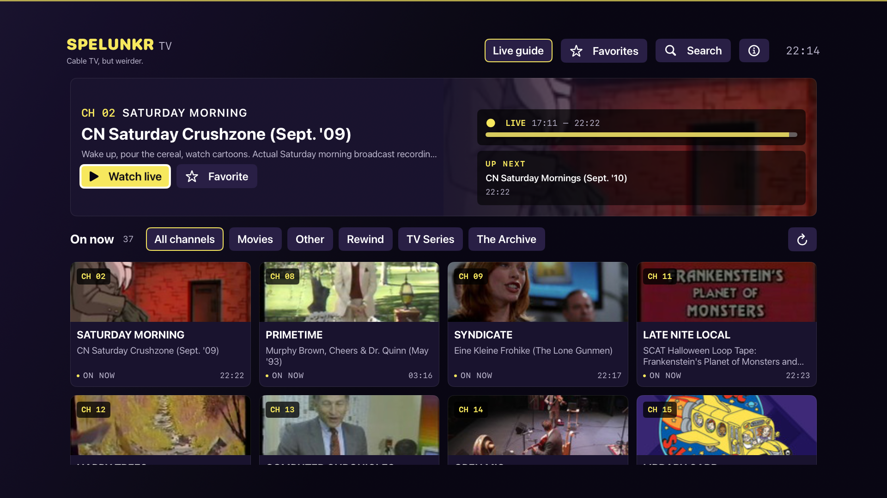

# Spelunkr for Apple TV

A native, unofficial tvOS frontend for [spelunkr.tv](https://spelunkr.tv/): cable TV, but weirder.

Licensed under [GPL-3.0-or-later](LICENSE).

Browse the real channel lineup, join whatever is on now, and keep watching as the broadcast rolls into the next program. The app uses SwiftUI for the guide and Apple's AVKit player for Internet Archive video. No account, API key, backend, or third-party runtime dependency is required.



## Features

- Remote-friendly channel guide with program artwork, current/next programs, and categories.
- Search by channel, program, description, or channel number.
- Favorites saved on the Apple TV.
- Native video controls, channel switching, and a Return to live action.
- The site's synchronized scheduling, including trimmed recordings, station breaks, up-next cards, and period advertisements.
- Timed station-break text and music, plus slideshow-channel audio overlays with track attribution.
- Explicit loading/retry states and the website's backup catalog when the primary host is unavailable.
- VoiceOver labels, clear focus outlines, and Reduce Motion support.

## Run

1. Open `SpelunkrTV.xcodeproj` in Xcode with the tvOS platform installed (Xcode 16.4 or later).
2. Select the **SpelunkrTV** scheme and an Apple TV simulator, then Run.
3. To run on your Apple TV, sign in to an Apple Account belonging to **OnePatchDown, LLC** in Xcode Settings → Apple Accounts. Automatic signing is configured for that team (`THSJJN6KNN`). Pair the TV in Xcode and select it as the destination. Other developers should select their own team. The repository does not contain signing credentials.

Minimum deployment target: **tvOS 18.0**. Swift 6 language mode and complete concurrency checking are enabled. The checked-in Xcode project is ready to open; XcodeGen is only needed after changing `project.yml`:

```sh
xcodegen generate
```

On this development Mac, Xcode 26.3 and the tvOS 26.2 platform are installed in `/Applications/Xcode_26.3.app`. The original simulator checks used Xcode 16.4 and tvOS 18.5 in `/Applications/Xcode.app`; that installation remains available. To build with the current toolchain explicitly:

```sh
DEVELOPER_DIR=/Applications/Xcode_26.3.app/Contents/Developer xcodebuild \
  -project SpelunkrTV.xcodeproj -scheme SpelunkrTV \
  -destination 'generic/platform=tvOS Simulator' \
  -derivedDataPath build/DerivedData26 build CODE_SIGNING_ALLOWED=NO
```

## Signing and distribution

The XcodeGen source and checked-in project select OnePatchDown, LLC (`THSJJN6KNN`) for automatic signing. The bundle identifier is `org.fragmede.SpelunkrTV`. Xcode needs a signed-in account with access to this team and permission to create provisioning profiles. If Apple reports **PLA Update available**, the team's Account Holder must accept the current Developer Program License Agreement on the Apple Developer website before provisioning can continue.

On the Apple TV, open Settings → Remotes and Devices → Remote App and Devices. With the Mac on the same network, open Xcode's Devices and Simulators window, select the TV, click Pair, and enter the code shown on the television. Then select the TV as the project's run destination.

Run a device build before the first archive so Xcode can register the paired TV and create its development profile. From the command line, use `-destination 'platform=tvOS,id=<TV identifier>' -allowProvisioningUpdates -allowProvisioningDeviceRegistration build`. An archive alone may report that the team has no registered devices. Keep the Apple TV awake when launching the installed app.

For a signed release archive:

```sh
DEVELOPER_DIR=/Applications/Xcode_26.3.app/Contents/Developer xcodebuild \
  -project SpelunkrTV.xcodeproj -scheme SpelunkrTV -configuration Release \
  -destination 'generic/platform=tvOS' -derivedDataPath build/Release26 \
  -archivePath build/OnePatchDown-Spelunkr.xcarchive \
  -allowProvisioningUpdates archive
```

Apple currently requires Xcode 26+ and the tvOS 26 SDK for App Store Connect uploads; the deployment target can remain tvOS 18. The app includes a required-reason privacy manifest for its app-only favorites preferences (`UserDefaults`, reason `CA92.1`). This declaration does not replace an App Store privacy policy or the release's privacy answers. Uploading an archive, creating TestFlight invitations, and submitting an App Store release are separate steps; a successful local archive does not perform them.

References: [Apple TV pairing](https://help.apple.com/xcode/mac/current/en.lproj/devbc48d1bad.html), [upload requirements](https://developer.apple.com/news/upcoming-requirements/), [required-reason privacy declarations](https://developer.apple.com/documentation/technotes/tn3183-adding-required-reason-api-entries-to-your-privacy-manifest).

## Remote controls

- Move around the guide with the directional pad; select a channel or **Watch live** to tune in.
- Use **Favorite** to save the previewed channel. Favorites and filters remain available while browsing.
- In the player, reveal the native playback controls, focus the **TV icon**, and select it for **Previous channel**, **Next channel**, **Return to live**, and **Channel guide**.
- Press Back/Menu to return to the guide. Play/Pause uses the native player. The channel's broadcast clock continues while paused; resuming or choosing Return to live rejoins the current program.
- In Simulator, the arrow keys and Return act as remote direction/select. Space is Play/Pause; Escape is Back/Menu.

## Verification

The core scheduler and client run independently of the UI:

```sh
swift test
# Optional: makes read-only requests to the actual broadcast endpoints.
SPELUNKR_LIVE_TESTS=1 swift test --filter LiveIntegrationTests
```

Run the remote-navigation and favorites tests with Product → Test in Xcode, or:

```sh
DEVELOPER_DIR=/Applications/Xcode.app/Contents/Developer xcodebuild \
  -project SpelunkrTV.xcodeproj -scheme SpelunkrTV \
  -destination 'platform=tvOS Simulator,name=Apple TV 4K (3rd generation) (at 1080p)' \
  -derivedDataPath build/DerivedData test CODE_SIGNING_ALLOWED=NO
```

The UI tests require network access. Core tests use synthetic fixtures and no network by default. See [tasks/todo.md](tasks/todo.md) for the actual validation record and [docs/integration.md](docs/integration.md) for the public data contract, parity-test provenance, and presentation limits.

On November 23, 2026, the signed Release archive built with Xcode 26.3 and the tvOS 26.2 SDK was installed and launched on an Apple TV (4th generation) running tvOS 26.6.1. The physical device loaded all 37 live channels, artwork, and current/upcoming programs. [Hardware screenshot](docs/screenshots/apple-tv-guide.png). Hardware playback and remote interaction remain to be exercised.

## Source and behavior

The app refreshes the catalog every 15 minutes and resolves program changes against the device clock. Enable automatic date and time on the Apple TV for accurate synchronization. The website can publish channels or schedules newer than its backup snapshot; the guide identifies backup use explicitly. Archive files may be unavailable or use codecs that Apple TV cannot play, in which case the player offers retry and channel switching.

The native station breaks preserve timing and text/music but do not reproduce decorative video clips. Separate translated subtitle sidecars and optional detailed film-credit documents are not loaded. Embedded subtitle tracks use the native player when provided by the original media. App Store submission and every individual Archive recording have not been verified.

Spelunkr provides the programming, curation, and broadcast data; the Internet Archive hosts the recordings. This is an independent client, not an official Spelunkr release. Media is streamed from its published origin and is not bundled or redistributed. Geometric app-icon artwork is original to this client; `scripts/generate_assets.py` reproduces it with Pillow.

## License

This client's source code and original assets are free software: you can redistribute them and/or modify them under the terms of the GNU General Public License as published by the Free Software Foundation, either version 3 of the License, or (at your option) any later version. The SPDX license identifier is `GPL-3.0-or-later`.

This software is distributed without any warranty; without even the implied warranty of merchantability or fitness for a particular purpose. See [LICENSE](LICENSE) for the full terms.

This license does not grant rights to Spelunkr's branding or broadcast data, streamed third-party media, or third-party program artwork visible in the documentation screenshots. Existing source and fixture attribution is recorded in [docs/integration.md](docs/integration.md) and the [fixture provenance](Tests/SpelunkrCoreTests/Fixtures/README.md).

## Structure

- `Sources/SpelunkrCore`: public data client, models, deterministic scheduling, and audio cues.
- `Tests/SpelunkrCoreTests`: synthetic schedule parity and network-fallback checks.
- `SpelunkrTV/App`: guide state, refresh, favorites, and app lifecycle.
- `SpelunkrTV/Guide` and `Design`: television UI and focus styling.
- `SpelunkrTV/Playback`: native player, live transitions, audio overlays, and recovery.
- `UITests`: Siri Remote navigation through the real app.
